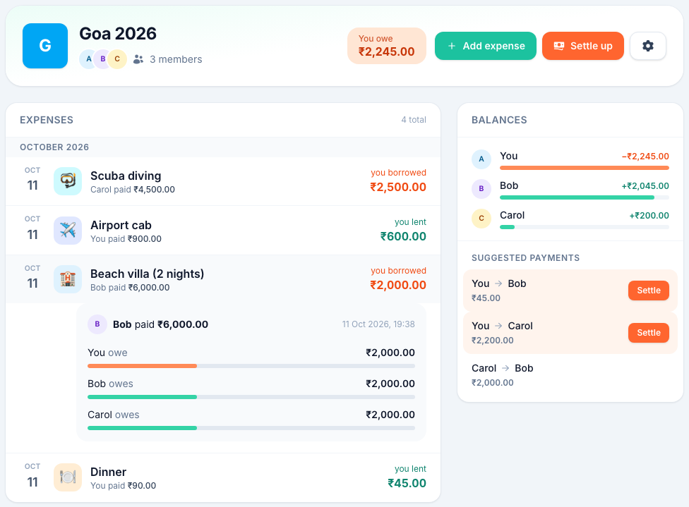
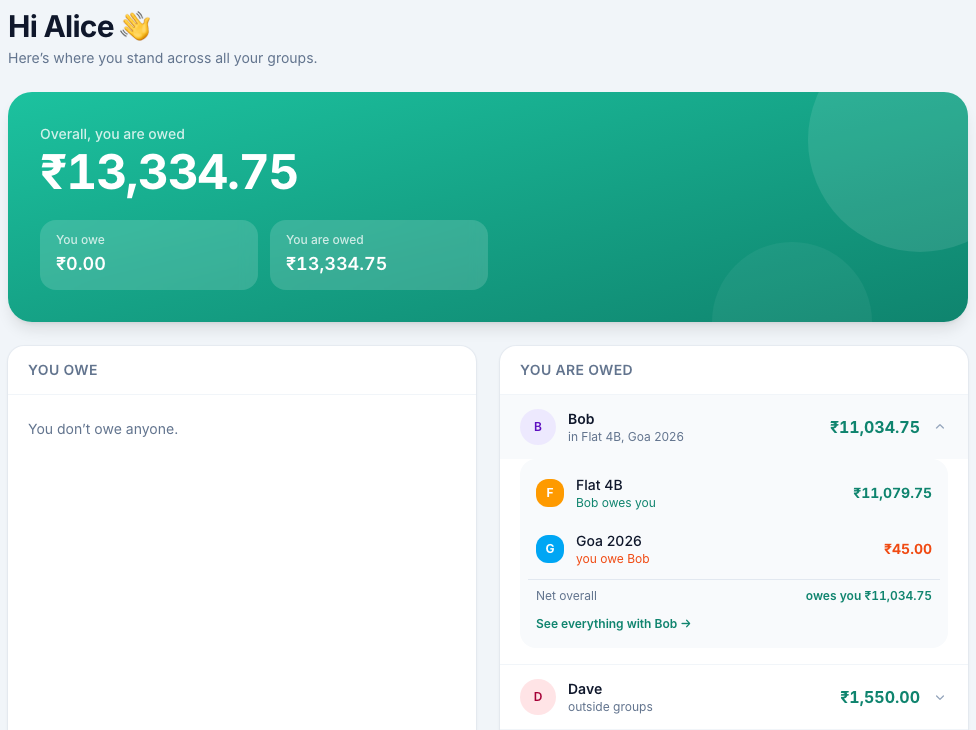
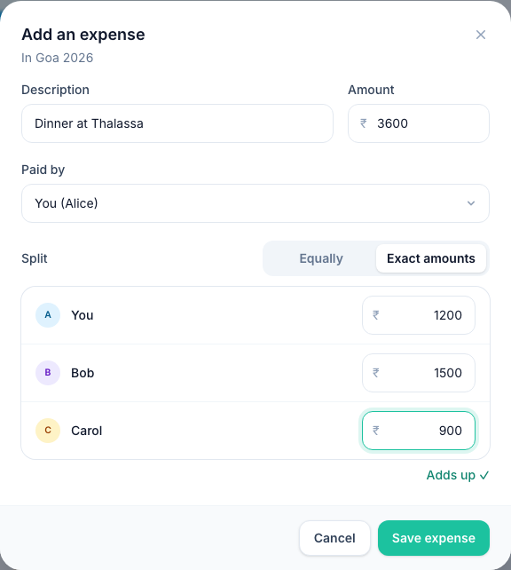
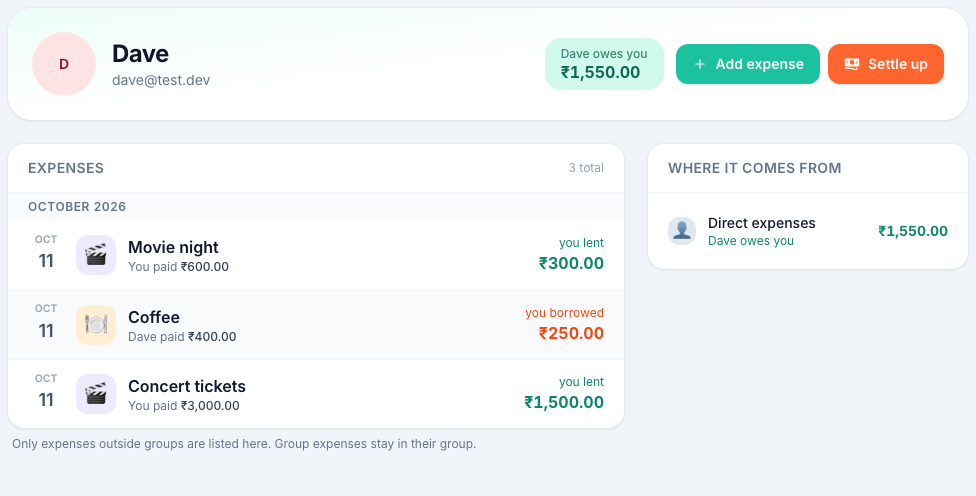
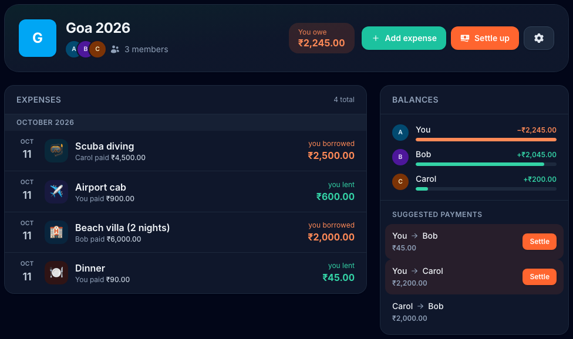
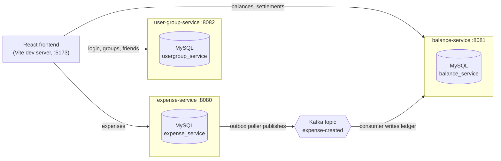

# Splitwise Clone

An expense-sharing app for groups and friends: add shared expenses, see who owes whom, and settle up. Built as three Spring Boot microservices that talk through Kafka, with a React frontend.



## Features

- **Groups**: create a group, add people by email, rename it, remove members or leave. The creator owns the group and is the only one who can delete it.
- **Friends and direct expenses**: add a friend by email and split expenses with them without making a group.
- **Equal or exact splits**: split equally between selected people, or enter exact amounts that must add up to the total.
- **Balances you can trace**: your overall balance with each person, broken down by group and direct expenses, plus suggested payments inside each group.
- **Settle up with confirmation**: the payer records a payment, and it only counts once the receiver confirms it.
- **Secure by default**: JWT login with short-lived access tokens and rotating refresh tokens. Every service checks the token itself.
- **Responsive UI with dark mode**: works on desktop and phone, and follows your system theme.

| Dashboard | Adding an expense |
|---|---|
|  |  |

| A friend's page | Dark mode |
|---|---|
|  |  |

## Architecture



- **Each service owns its database.** No service reads another's tables.
- **No service calls another over HTTP.** user-group-service signs JWTs with an RSA private key; the other two verify them with the public key.
- **Expenses reach balances through Kafka.** expense-service saves the expense and an outbox row in one transaction, and a poller publishes it. balance-service consumes the event idempotently and writes ledger entries. Balances are computed from the ledger when you ask for them.

The full reasoning, trade-offs and known gaps are in **[backend/DESIGN-V1.md](backend/DESIGN-V1.md)**.

## Tech stack

| | |
|---|---|
| Backend | Java 21, Spring Boot 4.1, Spring Security, Spring Data JPA, Spring Kafka, jjwt (RSA-signed JWTs) |
| Messaging | Apache Kafka (Aiven, SASL_SSL + SCRAM-SHA-256) |
| Database | MySQL, one schema per service |
| Frontend | React 19, TypeScript, Vite, Tailwind CSS v4 |

## Running it locally

### Prerequisites

- Java 21 (the services ship with the Maven wrapper, so Maven itself isn't needed)
- Node.js 20.19+ or 22.12+ (required by Vite)
- MySQL running on `localhost:3306`. Each service creates its own database on first start.
- A Kafka cluster. The services are set up for [Aiven](https://aiven.io) (SASL_SSL with SCRAM-SHA-256). If your cluster doesn't create topics automatically, create a topic named `expense-created`.

### 1. Generate the JWT key pair

user-group-service signs tokens with the private key; the other services only need the public key. Keep both outside the repo:

```bash
mkdir -p ~/splitwise-keys && cd ~/splitwise-keys
openssl genpkey -algorithm RSA -pkeyopt rsa_keygen_bits:2048 -out private.pem
openssl rsa -in private.pem -pubout -out public.pem
```

### 2. Configure each service

Each service has an `application.properties.example` in `src/main/resources/`. Copy it to `application.properties` (which is gitignored) and fill in your values:

```bash
cd backend
for s in user-group-service expense-service balance-service; do
  cp $s/src/main/resources/application.properties.example $s/src/main/resources/application.properties
done
```

- **All services:** MySQL username and password.
- **expense-service and balance-service:** Kafka bootstrap server, username and password. Download your cluster's CA certificate and save it as `ca.pem` in each of their `src/main/resources/` folders (also gitignored).

> The example files use `spring.jpa.hibernate.ddl-auto=update`, which keeps your data between restarts. `create` drops and recreates every table each time a service starts.

### 3. Start the services

In separate terminals:

```bash
cd backend/user-group-service && ./mvnw spring-boot:run   # :8082
cd backend/expense-service    && ./mvnw spring-boot:run   # :8080
cd backend/balance-service    && ./mvnw spring-boot:run   # :8081
```

### 4. Start the frontend

```bash
cd frontend
npm install
npm run dev
```

Open **http://localhost:5173** and create an account. The Vite dev server proxies each `/api/v1/...` path to the service that owns it, so the backends don't need CORS.

> New expenses take a few seconds to show up in balances: the outbox poller publishes every 5 seconds and balance-service then consumes the event. The UI reloads balances automatically.

## API overview

All endpoints except register, login and refresh need `Authorization: Bearer <access token>`. The caller's identity always comes from the token.

| Service | Endpoints |
|---|---|
| **user-group-service** | `POST /api/v1/auth/register`, `/login`, `/refresh` · `GET /api/v1/users/me` · `GET /api/v1/users?ids=` · `GET/POST /api/v1/groups` · `GET/PATCH/DELETE /api/v1/groups/{id}` · `POST /api/v1/groups/{id}/members` · `DELETE /api/v1/groups/{id}/members/{userId}` · `GET/POST /api/v1/friends` |
| **expense-service** | `POST /api/v1/expenses` (equal or custom split) · `GET /api/v1/expenses/{id}` · `GET /api/v1/expenses?groupId=` · `GET /api/v1/expenses/direct?with=` |
| **balance-service** | `GET /api/v1/balances?groupId=` · `GET /api/v1/balances/users/{userId}` · `GET /api/v1/balances/direct?with=` · `GET/POST /api/v1/settlements` · `GET /api/v1/settlements/{id}` · `POST /api/v1/settlements/{id}/acknowledge` · `POST /api/v1/settlements/{id}/reject` |

Request and response shapes, status codes and access rules are in [backend/DESIGN-V1.md](backend/DESIGN-V1.md).

## Project structure

```
backend/
  user-group-service/   users, auth (JWT + refresh tokens), groups, friends
  expense-service/      expenses and splits, transactional outbox → Kafka
  balance-service/      Kafka consumer, ledger, balances, settlements
  DESIGN-V1.md          design decisions, API details, known gaps
frontend/               React + TypeScript + Tailwind app
images/                 screenshots for this README
```

## Known limitations

This is a learning project, and some things are deliberately left for later:

- expense-service and balance-service don't yet check that the people in a group expense or settlement actually belong to the group.
- Deleting a group, or removing a member who still owes money, leaves their expenses and balances in place.
- There's no logout endpoint, so a refresh token stays valid until it expires.
- There are no automated tests yet.

See the **Known gaps** section of [backend/DESIGN-V1.md](backend/DESIGN-V1.md) for the full list.
